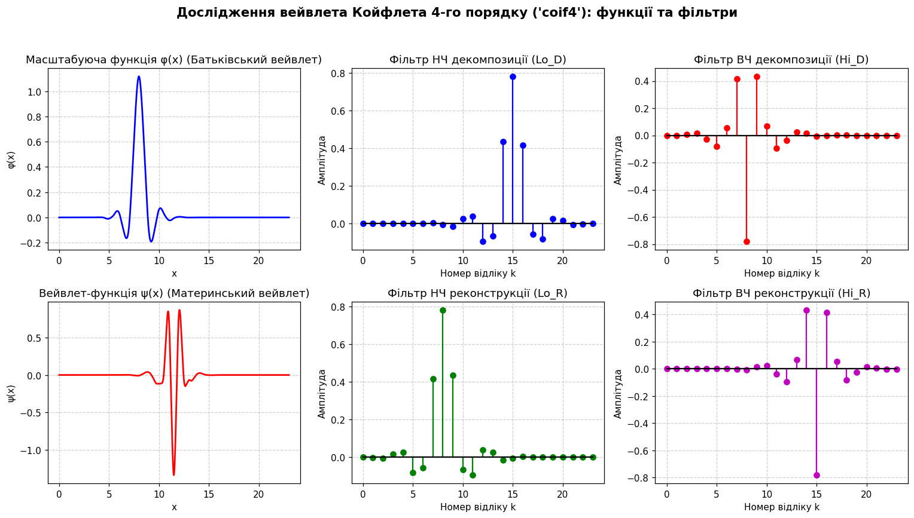
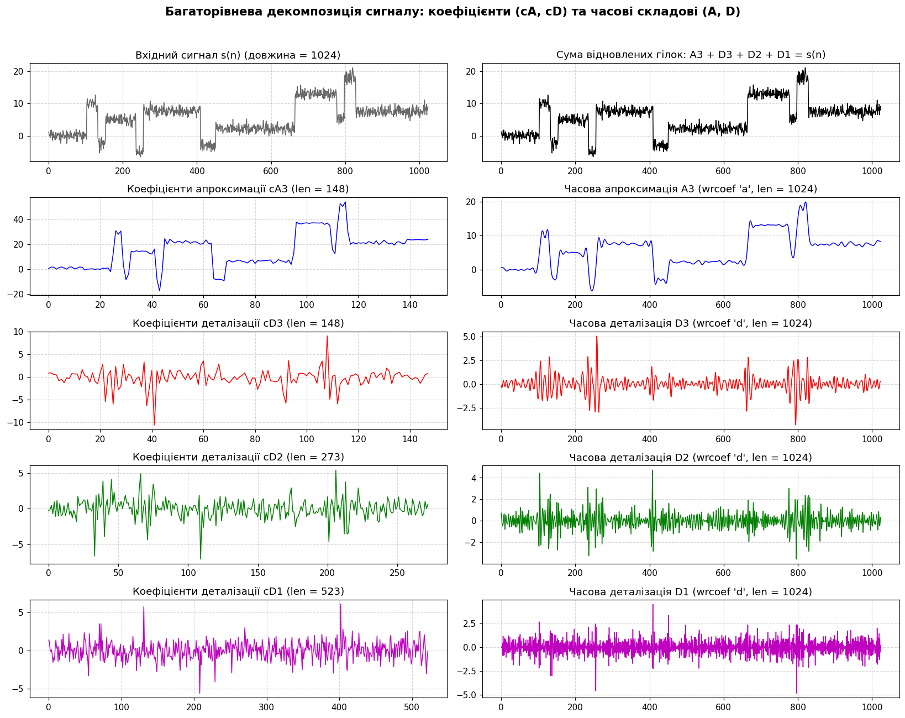
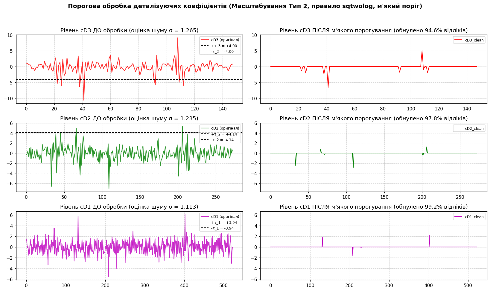
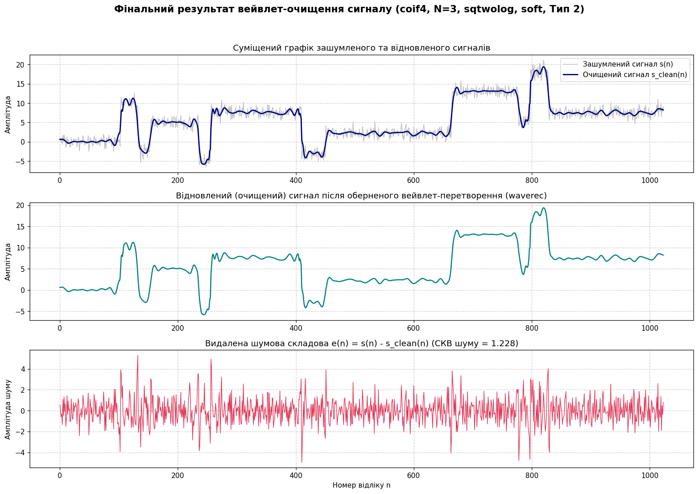

# Лабораторна робота №5: Обчислення вейвлет-коефіцієнтів. Пряме і обернене вейвлет-перетворення

**Дисципліна:** Основи цифрової обробки сигналів  
**Університет:** Національний університет «Львівська політехніка» (ІКТА, кафедра КСА)  
**Виконав:** Гада Артем, група ІР-44  
**Прийняв:** док. філософії, асистент Сухолейстер О. О.  
**Варіант:** №5

---

## Мета роботи
Ознайомитися з основними можливостями дискретного вейвлет-перетворення (ДВП), засвоїти практичні навички багаторівневої декомпозиції сигналу на апроксимуючі та деталізуючі складові за алгоритмом Маллата, а також виконати вейвлет-очищення нестаціонарного сигналу від шуму.

---

## Завдання (Варіант 5)

| Параметр | Значення |
| :--- | :--- |
| **Тип вейвлету** | Койфлета 4-го порядку (`coif4`) |
| **Рівень розкладу ($N$)** | $3$ |
| **Правило вибору порогу** | `sqtwolog` (універсальний поріг Донохо — Джонстоуна) |
| **Тип порогування** | М’який (`soft`) |
| **Масштабування порогу** | Тип 2 (по-рівнева оцінка шуму) |
| **Вхідний файл** | `Lab_3_5.mat` / `Lab_5_5.mat` (змінна `signal`, $1024$ відліки) |

Програмна реалізація виконана мовою Python (`PyWavelets`, `SciPy`, `NumPy`, `Matplotlib`) з повним відтворенням функціоналу MATLAB Wavelet Toolbox (`waveinfo`, `wavefun`, `wfilters`, `wavedec`, `appcoef`, `detcoef`, `wrcoef`, `wnoisest`, `thselect`, `waverec`).

---

## Математична модель та результати обчислень

### 1. Параметри вейвлета `coif4` та структура розкладу $[C, L]$
Вейвлет Койфлета 4-го порядку є ортогональним, майже симетричним (`near symmetric`) і має довжину фільтрів Маллата $L_{\text{ф}} = 6 \cdot 4 = 24$ коефіцієнти.

На кожному рівні декомпозиції застосовується фільтрація (`Lo_D`, `Hi_D`) та децимація ($\downarrow 2$), внаслідок чого довжина векторів обчислюється за формулою:

$$n_j = \left\lfloor \frac{n_{j-1} + L_{\text{ф}} - 1}{2} \right\rfloor$$

* **Вектор довжин:** $L = [148,\ 148,\ 273,\ 523,\ 1024]$ (загальна довжина вектора $C$ — $1092$ коефіцієнти).
* **Перевірка тотожності Маллата:** $\max |S - (A_3 + D_3 + D_2 + D_1)| = 1.78 \cdot 10^{-14}$.

### 2. Оцінка шуму (Тип 2) та м’яке порогування (`sqtwolog`)
Для кожного рівня деталізації $j \in \{1, 2, 3\}$ оцінюється стандартне відхилення шуму методом MAD та розраховується адаптивний поріг:

$$\sigma_j = \frac{\text{median}(|cD_j|)}{0.6745}, \qquad \tau_j = \sigma_j \cdot \sqrt{2 \ln(n_j)}$$

| Рівень деталізації | Кількість відліків ($n_j$) | Оцінка шуму ($\sigma_j$) | Базовий поріг $\sqrt{2\ln(n_j)}$ | Поріг $\tau_j$ | Обнулено коефіцієнтів |
| :---: | :---: | :---: | :---: | :---: | :---: |
| **$cD_3$** | $148$ | $1.2646$ | $3.1614$ | $3.9978$ | $140 / 148$ ($94.6\%$) |
| **$cD_2$** | $273$ | $1.2355$ | $3.3495$ | $4.1382$ | $267 / 273$ ($97.8\%$) |
| **$cD_1$** | $523$ | $1.1132$ | $3.5382$ | $3.9387$ | $519 / 523$ ($99.2\%$) |

До деталізуючих коефіцієнтів застосовано оператор м’якого порогування (апроксимація $cA_3$ не змінюється):

$$\widetilde{cD}_j(k) = \begin{cases} \text{sign}(cD_j(k)) \cdot (|cD_j(k)| - \tau_j), & |cD_j(k)| > \tau_j \\ 0, & |cD_j(k)| \le \tau_j \end{cases}$$

### 3. Оцінка якості відновлення сигналу
Після оберненого вейвлет-перетворення (`waverec`) з інтерполяцією ($\uparrow 2$) та фільтрами `Lo_R`, `Hi_R` отримано такі метрики:

* **СКВ вхідного сигналу $s(n)$:** $5.0834$
* **СКВ очищеного сигналу $s_{\text{clean}}(n)$:** $4.9038$
* **СКВ видаленого шуму $e(n) = s(n) - s_{\text{clean}}(n)$:** $1.2282$
* **Оцінка відношення Сигнал/Шум ($\text{SNR}$):** $15.63\text{ дБ}$

---

## Графічні результати

### 1. Властивості вейвлета `coif4` та фільтри Маллата


### 2. Багаторівнева декомпозиція та відновлення часових гілок (`wrcoef`)


### 3. Порогова обробка деталізуючих коефіцієнтів із межами $\pm \tau_j$


### 4. Фінальний результат очищення та виділена шумова складова


---

## Структура папки та запуск

```text
lab5/
├── Lab_3_5.mat                     # Вхідний сигнал (або Lab_5_5.mat)
├── lab5_wavelet.py                 # Скрипт вейвлет-аналізу та очищення
├── lab5_1_wavelet_info.png         # Графік φ(x), ψ(x) та фільтрів
├── lab5_2_decomposition_tree.png   # Коефіцієнти та часові гілки A3, D1-D3
├── lab5_3_thresholding_levels.png  # Деталізації до та після порогування
├── lab5_4_final_denoising.png      # Очищений сигнал та видалений шум
└── README.md
```

### Встановлення залежностей та запуск
```bash
pip install numpy scipy matplotlib PyWavelets
python lab5_wavelet.py
```

---

## Висновки
Застосування трирівневого дискретного вейвлет-перетворення на базі `coif4` із по-рівневим масштабуванням порогу (Тип 2), правилом `sqtwolog` та м’яким порогуванням дозволило обнулити $94.6\%\text{--}99.2\%$ шумових коефіцієнтів деталізації. Завдяки частотно-часовій локалізації вейвлетів було усунено високочастотну заваду на горизонтальних ділянках із повним збереженням крутизни ступінчастих переходів корисного сигналу.